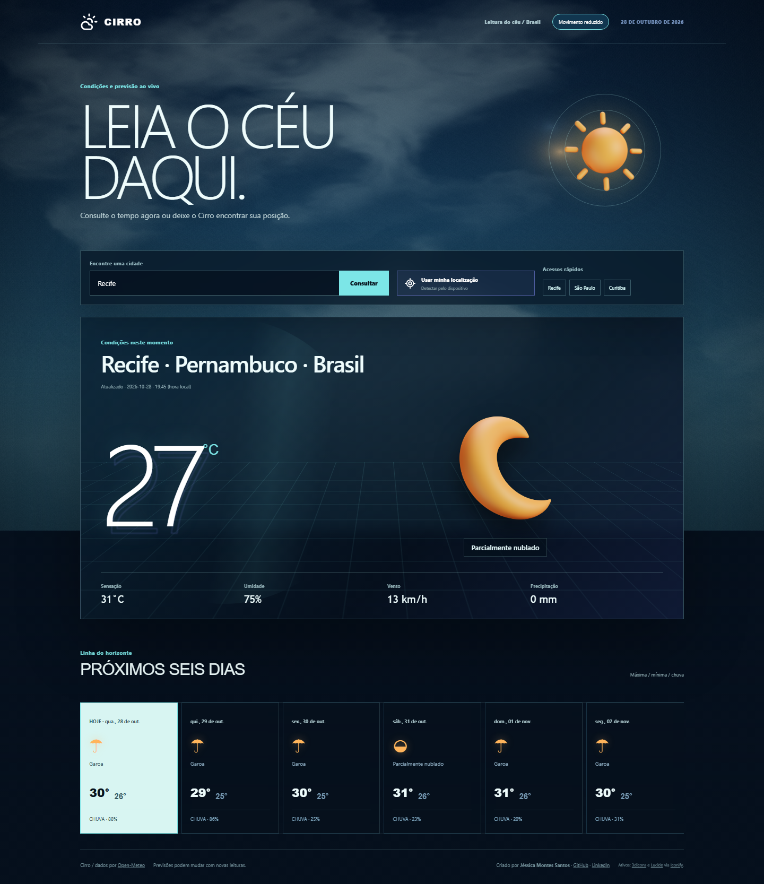

# Cirro — boletim meteorológico

Abra `index.html` com conexão à internet. Não é necessário servidor local ou chave de API.

## Funcionalidades
- Consulta de cidades com desambiguação de localidades.
- Identificação direta da localização atual pela Geolocation API do navegador, sempre mediante permissão.
- Conversão das coordenadas autorizadas no nome da cidade por geocodificação reversa.
- Temperatura, sensação térmica, umidade, vento, precipitação e condições atuais.
- Previsão para seis dias, incluindo máximas, mínimas e probabilidade máxima de chuva.
- Objetos meteorológicos 3D públicos que mudam conforme a condição, com profundidade por ponteiro e alternativa sem movimento.
- Requisições `fetch` com `async/await`, tratamento de erros e cancelamento de consultas anteriores (`AbortController`).
- Lembra a última localidade consultada no navegador.

## APIs
- Previsão: https://open-meteo.com/en/docs
- Geocodificação: https://open-meteo.com/en/docs/geocoding-api
- Geocodificação reversa da localização atual: https://api.bigdatacloud.net/data/reverse-geocode-client

O tempo de atualização depende da fonte. Os dados são previsões, não medições garantidas; a aplicação exibe o horário informado pela API. Acesso à internet obrigatório para novas consultas. Uso não comercial conforme os termos do provedor.
